## 👋 About me

I’m **Steven Zeng**, a full-stack developer based in Vancouver, BC. At **BCIT**, I build web tools for teaching and learning.

I work with **React, TypeScript, Next.js, and Python/FastAPI**, with an interest in UI/UX, reusable components, and accessible design.

I use AI tools regularly in both my work and personal projects, exploring practical ways to turn ideas into useful applications.

### AI tools I use

<picture>
  <source media="(prefers-color-scheme: dark)" srcset="assets/redesign/ai-claude.svg">
  
</picture>
<picture>
  <source media="(prefers-color-scheme: dark)" srcset="assets/redesign/ai-claude-code.svg">
  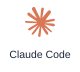
</picture>
<picture>
  <source media="(prefers-color-scheme: dark)" srcset="assets/redesign/ai-gemini.svg">
  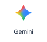
</picture>
<picture>
  <source media="(prefers-color-scheme: dark)" srcset="assets/redesign/ai-chatgpt.svg">
  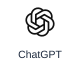
</picture>
<picture>
  <source media="(prefers-color-scheme: dark)" srcset="assets/redesign/ai-codex.svg">
  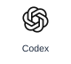
</picture>

## ⚡ What I bring

<picture>
  <source media="(prefers-color-scheme: dark)" srcset="assets/redesign/feature-full-stack.svg">
  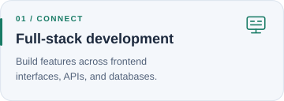
</picture>
<picture>
  <source media="(prefers-color-scheme: dark)" srcset="assets/redesign/feature-ui.svg">
  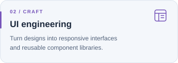
</picture>

<picture>
  <source media="(prefers-color-scheme: dark)" srcset="assets/redesign/feature-testing.svg">
  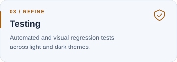
</picture>
<picture>
  <source media="(prefers-color-scheme: dark)" srcset="assets/redesign/feature-ownership.svg">
  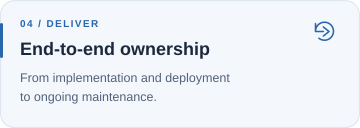
</picture>

My background in **electrical engineering** shapes how I approach systems and solve problems.

## 🧩 My toolkit

<picture>
  <source media="(prefers-color-scheme: dark)" srcset="assets/redesign/skill-typescript.svg">
  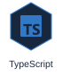
</picture>
<picture>
  <source media="(prefers-color-scheme: dark)" srcset="assets/redesign/skill-react.svg">
  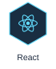
</picture>
<picture>
  <source media="(prefers-color-scheme: dark)" srcset="assets/redesign/skill-nextjs.svg">
  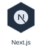
</picture>
<picture>
  <source media="(prefers-color-scheme: dark)" srcset="assets/redesign/skill-mui.svg">
  
</picture>
<picture>
  <source media="(prefers-color-scheme: dark)" srcset="assets/redesign/skill-python.svg">
  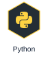
</picture>
<picture>
  <source media="(prefers-color-scheme: dark)" srcset="assets/redesign/skill-fastapi.svg">
  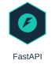
</picture>
<picture>
  <source media="(prefers-color-scheme: dark)" srcset="assets/redesign/skill-postgresql.svg">
  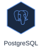
</picture>
<picture>
  <source media="(prefers-color-scheme: dark)" srcset="assets/redesign/skill-docker.svg">
  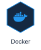
</picture>
<picture>
  <source media="(prefers-color-scheme: dark)" srcset="assets/redesign/skill-storybook.svg">
  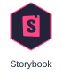
</picture>
<picture>
  <source media="(prefers-color-scheme: dark)" srcset="assets/redesign/skill-vitest.svg">
  
</picture>
<picture>
  <source media="(prefers-color-scheme: dark)" srcset="assets/redesign/skill-git.svg">
  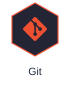
</picture>

## 🏸 Beyond code

<picture>
  <source media="(prefers-color-scheme: dark)" srcset="assets/redesign/beyond.svg">
  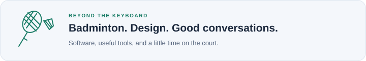
</picture>

## 💬 Let’s connect

<a href="https://www.czsteven.com/">
  <picture>
  <source media="(prefers-color-scheme: dark)" srcset="assets/redesign/contact-portfolio.svg">
  
</picture>
</a>
<a href="https://www.linkedin.com/in/chenzeng91/">
  <picture>
  <source media="(prefers-color-scheme: dark)" srcset="assets/redesign/contact-linkedin.svg">
  
</picture>
</a>
<a href="mailto:zengks@outlook.com">
  <picture>
  <source media="(prefers-color-scheme: dark)" srcset="assets/redesign/contact-email.svg">
  
</picture>
</a>
