## 👋 A little about me

I’m a full-stack developer based in Vancouver, BC, building web tools for teaching and learning at **BCIT**.

I work with **React, TypeScript, Next.js, and Python/FastAPI**, with an interest in UI/UX, reusable components, and accessible design.

AI tools are a regular part of how I build software, both at work and in personal projects. I’m interested in practical ways to use them to turn ideas into useful applications.

## ⚡ What I bring

| Focus | How I work |
| :--- | :--- |
| 🟢 **Full-stack development** | Build features across frontend interfaces, APIs, and databases. |
| 🟣 **UI engineering** | Turn designs into responsive interfaces and reusable component libraries. |
| 🟠 **Testing** | Use automated tests and visual regression testing across light and dark themes. |
| 🔵 **End-to-end ownership** | Work through implementation, deployment, and ongoing maintenance. |

My background in **electrical engineering** shapes how I approach systems and solve problems.

## 🧩 My toolkit

**Interfaces**

<picture>
  <source media="(prefers-color-scheme: dark)" srcset="assets/skills/typescript.svg">
  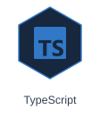
</picture>
<picture>
  <source media="(prefers-color-scheme: dark)" srcset="assets/skills/react.svg">
  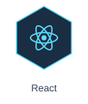
</picture>
<picture>
  <source media="(prefers-color-scheme: dark)" srcset="assets/skills/nextjs.svg">
  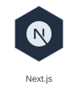
</picture>
<picture>
  <source media="(prefers-color-scheme: dark)" srcset="assets/skills/mui.svg">
  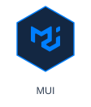
</picture>

**APIs & data**

<picture>
  <source media="(prefers-color-scheme: dark)" srcset="assets/skills/python.svg">
  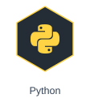
</picture>
<picture>
  <source media="(prefers-color-scheme: dark)" srcset="assets/skills/fastapi.svg">
  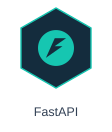
</picture>
<picture>
  <source media="(prefers-color-scheme: dark)" srcset="assets/skills/postgresql.svg">
  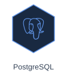
</picture>

**Quality & delivery**

<picture>
  <source media="(prefers-color-scheme: dark)" srcset="assets/skills/docker.svg">
  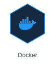
</picture>
<picture>
  <source media="(prefers-color-scheme: dark)" srcset="assets/skills/storybook.svg">
  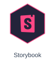
</picture>
<picture>
  <source media="(prefers-color-scheme: dark)" srcset="assets/skills/vitest.svg">
  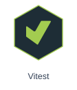
</picture>
<picture>
  <source media="(prefers-color-scheme: dark)" srcset="assets/skills/git.svg">
  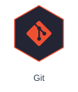
</picture>

## 🏸 Beyond code

I enjoy badminton and conversations about software, design, and useful tools.

## 💬 Let’s connect

